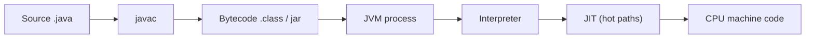

# Month 1 · Day 1 — How Code Works

**Folder:** `java-learning/month-01-basic/day-01-how-code-works/`
**Depth:** Experienced backend engineer level — not a textbook dump.
**Note:** Interview Q packs come after Month 1 revision — not on this day.
**How to revise this note:** Layer 1 (30 sec) → Layer 2 (2 min) → Layer 3 (full). Stop at the layer you need. If a self-check at the end fails, jump back to that section only.

---

## Layer 1 — 30-second revision

```text
CPU only runs machine code. It never runs your source.
We write source code for humans (team, review, maintainability).
Between the two, translation is compulsory — there is no shortcut.
Java does it in two stages:
  .java → javac → bytecode (.class, usually shipped as jar) → JVM → machine code → CPU
We ship bytecode. We run a JVM process. CPU runs that process's machine code.
```

If this much is clear without thinking, Day 1 is still alive in memory.

---

## Layer 2 — 2-minute revision

### The Java path

```text
Write .java
  → javac                    (first translation — before run)
  → .class (bytecode)        (tied to the JVM, not to one CPU)
  → package jar
  → start JVM process        (the "service is up")
  → execute bytecode         (interpret first)
  → JIT compiles hot paths   (second translation — during run)
  → CPU runs native instructions
```



### Source vs Bytecode vs Machine Code

| Form | Written for | Executed by | Tied to |
|---|---|---|---|
| Source (`.java`) | Humans — team, review, maintenance | Nothing directly | The language |
| Bytecode (`.class`) | The JVM | JVM | JVM spec, not one CPU |
| Machine code | The chip | CPU | CPU architecture (x86-64, ARM, …) |

**The one-line separation to never mix up:**

```text
Source → humans
Bytecode → JVM
Machine code → CPU
javac ≠ JIT   (before run ≠ during run)
```

---

## Layer 3 — Full explanation (as taught, in depth)

### 1.1 — CPU only runs machine code

In production people say "Java is running on the server." That is fine team shorthand — everyone understands it. But inside, an experienced developer holds a more precise picture:

- A CPU does not see "Java", "PHP", or "Python". It has no idea these names exist.
- A CPU is a chip with a fixed set of instructions — fetch a value, add, compare, jump. In the end these are binary patterns (0/1) for that chip's architecture: x86-64 on most servers today, ARM on many cloud instances (e.g. Graviton).
- You cannot tell a CPU: *"take Radha order 1024, compute its total, check payment."* That is business language. The chip only understands those tiny instructions.
- So whatever program actually runs — whatever language it started in — it must end up as machine instructions before silicon can execute it. The electricity that burns is never your source file; it is the translated form of it.

This is the root everything else hangs from. If this is clear, JVM, bytecode, Docker, and "why is the CPU high" all have a place to sit. If it is not, everything after becomes definitions to memorize.

> "CPU never runs my source. It only runs machine code for that chip."

**PHP connect (useful if you come from PHP):** the same truth held there too — the CPU never ran your `.php` file either. Something in between translated/executed it. Java just makes the stages more visible and more separate, which is exactly why it is a good place to build this mental model properly.

---

### 1.2 — Source code is written for humans

`A .java` file (like a `.php` file before it) is, at the bottom, just a text file written under some rules. Its job is **not** to be executed by a chip. Its job is to hold business thinking in a form that:

- you can read again after six months and understand,
- another developer on the team can read and review in a pull request,
- can be changed safely when a requirement changes,
- can be discussed: *"is this discount logic right?"*

Imagine writing "if payment is done, only then send the order for packing" directly in machine instructions — 0s, 1s, chip opcodes. No one could write it, read it, review it, or change it. A small OMS would take forever and then be unmaintainable.

So the industry made a deal, and that deal is what a programming language is:

> We write in a human-friendly form. Someone else's job is to carry it to the machine.

The beginner correction is subtle but important: the source file is **not** "the real program running on the server." It is the team's communication medium — it lives in Git, gets reviewed in PRs, and carries the business intent. The machine wants only one thing — machine code — and the source file is not that.

> "Sir, source code main apni team ke liye likhta hoon, taaki business logic saaf, padhne layak aur badalne layak rahe. CPU use seedha execute nahi karta — woh iska translated roop chalata hai."

---

### 1.3 — Translation in between is compulsory

Now there is an obvious gap:

- One side: a source file the machine cannot understand.
- Other side: a CPU that refuses anything but machine instructions.

Something must stand in the middle and convert one into the other. That is **translation**.

This is not an optional extra or a Java quirk. It is a compulsion. No program in any language escapes it. The only differences between languages are **when** the translation happens and **who** does it.

A plain analogy: you speak only Hindi, the other engineer speaks only German. You can speak perfectly and still not be understood. A translator listens to one side and speaks the other. Same situation:

- Your "language" = source code, made for humans.
- CPU's "language" = machine code, made for the chip.
- The translator = software that converts source into machine code.

Translation does two more jobs that seniors rely on when debugging:

1. **It removes an impossible job.** We never have to write business logic in machine code. We write for humans; the translator produces the machine's food.
2. **It catches many mistakes early.** A translator reads your file while converting. Wrong syntax, a wrong name — it stops there and says *"this line makes no sense."* That red error before anything runs means: **your file failed at the translation stage; it never reached the CPU.**

That distinction is a first-response skill in production. When something breaks, a senior asks:

> "Where is the problem — in my written logic, in the translation/build stage, or in the actually running program?"

All three have different fixes. Calling all of it "code is not working" is shooting in the dark.

> "Source se CPU tak ka rasta hamesha translation se hokar jaata hai — koi shortcut nahi hai."

---

### 1.4 — Java's path: translation in two stages

Java's specific identity is this: **translation happens twice.**

**Step 1 — You write `.java`.**
Human form. Team reads it, reviews it, changes it.

**Step 2 — `javac` translates it (first translation, before run).**
`javac` reads your source, checks it, and converts it. But be precise here — **`javac` does not produce machine code.** If it did, Java would just be the old native route.

**Step 3 — The output is bytecode (`.class`).**
Bytecode is a middle form. It is not source (humans don't maintain it) and not machine code (no real chip runs it directly). It is instructions for a *virtual* machine — a machine defined in software, not in silicon.

Its power follows directly: bytecode is **not tied to one CPU**. The same `.class` can travel to different servers, as long as a compatible JVM is there. That is the real meaning behind "write once, run anywhere" — it is not magic and it is not absolute (runtime version, architecture, and native libraries still matter).

**Step 4 — The JVM runs it.**
The JVM is a program running on the real server. It loads your bytecode and executes it. Today the JVM is only a box on this map — how it works inside is its own deep day (Month 1, Day 3). Do not mix them.

**Step 5 — While running, hot code becomes machine code (second translation, during run).**
At first, bytecode is executed more directly/stepwise (interpreted). Code that runs again and again — a method hit on every request — gets noticed, and the **JIT** compiles it *then and there* into machine code for *this* CPU. After that, calls take the fast path. If assumptions break, the JVM can fall back (deoptimize) — correctness first.

At the end of this whole road, we are back where Section 1.1 started: the CPU finally got its own language.

```text
.java → javac → bytecode (.class) → JVM → machine code → CPU
```

#### Two senior takeaways from this map

**1. "Where did it fail?" has two distinct stages in Java.**
- Fails at `javac` → the file never became bytecode. A *before-run* (build/compile) failure.
- Bytecode built fine but crashes while running → a *JVM-time* (runtime) failure.
Different stage, different search, different fix.

**2. What you ship is not your `.java` file.**
You ship bytecode — usually packed as a **jar**. It runs on a JVM on the server. A senior therefore says *"I deployed a new artifact,"* not *"I put Java files on the server."* The words reveal the model.

**Versus PHP (so the contrast sticks):** in typical PHP work, files were placed on the server and parsed/executed there — the "built artifact" stage was not this visible or separable. Java deliberately separates **building** from **running**, so the built artifact can be tested, versioned, promoted, and rolled back.

#### Common mix-up to kill today

| Thing | When | Job |
|---|---|---|
| `javac` | Before run | Source → bytecode |
| JVM | During run | The process that executes bytecode |
| JIT | During run, for hot code | Bytecode → machine code for this CPU |

`javac` ≠ JIT. One happens on the build machine before anything runs; the other happens inside the running process.

> "Sir, Java me translation do stage me hota hai. Pehle `javac` source ko bytecode me badalta hai, jo kisi ek CPU se bandha nahi hota. Phir server par JVM us bytecode ko chalati hai aur garam code ko wahi machine code me badal deti hai. Isi liye main bytecode ship karta hoon, source nahi."

---

### 1.5 — This map on Radha Enterprise

When Radha's API is live and someone says *"the Radha server is running,"* internally this is what is true:

1. Code was written as source — for the team, for the business logic.
2. `javac` translated it to bytecode; that bytecode was packed into a **jar** and shipped to the server.
3. On the server, no `.java` file runs. A **JVM process** loaded that jar and is handling orders, payments, tenants — threads, heap, CPU all belong to *that process*.
4. Underneath, the CPU executes that process's machine instructions.

This picture pays for itself repeatedly:

- **Deploy / rollback** = ship a built artifact / bring back the old artifact. Not copying source.
- **Scale** = more instances ≈ more JVM processes. Not "make Java faster" in the abstract.
- **Slow first minutes after deploy** — expected before judging: JVM warm-up (JIT compiling hot paths, caches filling). Steady state is what capacity decisions should use. Load-testing only the first 15 seconds draws the wrong conclusion about Java.
- **An incident** starts with: *was the artifact built? is the JVM process alive? did it die at build stage, at start, or while running?* — not with "Java language is slow."

> "For Radha I'll build and ship bytecode in a jar. At runtime we run a JVM process. The CPU executes machine instructions for that process. So when we talk scale, memory, or CPU, we're talking about JVM processes — not source files."

---

## Layer 4 — Experienced lens

### What breaks in production (and what this day prevents)

| Symptom | Precise way to think about it |
|---|---|
| "Java is not on the server" (vague) | Which stage is missing — build tools, artifact, or a running JVM process? |
| Load test looks bad right after deploy | Warm-up (JIT, caches, pools) — measure steady state |
| Crash after code reaches server | Was it a build failure, a start failure, or a runtime failure inside the JVM? |
| "It works on my machine" | Same artifact? Same runtime? Or did source differ from what shipped? |

### Junior vs senior

| Junior | Senior |
|---|---|
| "My `.java` file runs on the server" | "We ship bytecode; a JVM process runs it" |
| "Java is slow" after a cold start | Checks warm-up first, judges steady state |
| One word — "error" — for every failure | Separates build stage vs runtime stage |
| "Deploy" = copy files over | Deploy = promote an artifact; rollback = old artifact |
| Explains with definitions | Explains with what ships, what runs, what burns CPU |

### Spoken explanation (say it in your own words — do not memorize)

> "Sir, mera source code CPU nahi chalata. CPU sirf machine code chalata hai. Java me main pehle source ko `javac` se bytecode me badalta hoon, woh bytecode main jar ke roop me ship karta hoon. Server par JVM us bytecode ko chalati hai, aur garam code ko wahi machine code me badal deti hai. To jab main kehta hoon Radha ki service up hai, mera matlab hai ek JVM process chal rahi hai jo mere bytecode ko load karke requests sambhal rahi hai."

---

## Layer 5 — Self-check (without looking)

Answer aloud or in writing. If any answer is shaky, re-read only that section.

1. What does a CPU actually execute? *(→ 1.1)*
2. Who is source code written for, and why not write machine code directly? *(→ 1.2)*
3. Why is translation compulsory for every language, and what extra job does it do? *(→ 1.3)*
4. Walk the Java path end to end. Where does `javac` end and the JVM begin? Where does JIT fit? *(→ 1.4)*
5. For Radha: what do we ship, what runs on the server, and what does "scale" mean in this picture? *(→ 1.5)*

### Memory anchors

```text
Source → humans
Bytecode → JVM
Machine code → CPU

.java → javac → .class → JVM → interpret → JIT(hot) → CPU

Ship jar/bytecode. Run JVM process. Warm-up is real. javac ≠ JIT.
```

### Explicitly not today (and where it comes)

- Inside the JVM (class loading, memory, GC) — **Month 1, Day 3**
- JDK (build side) — **Month 1, Day 4**
- Java runtime / JRE story (run side) — **Month 1, Day 5**
- What exactly we ship — **Month 1, Day 2** (next)
